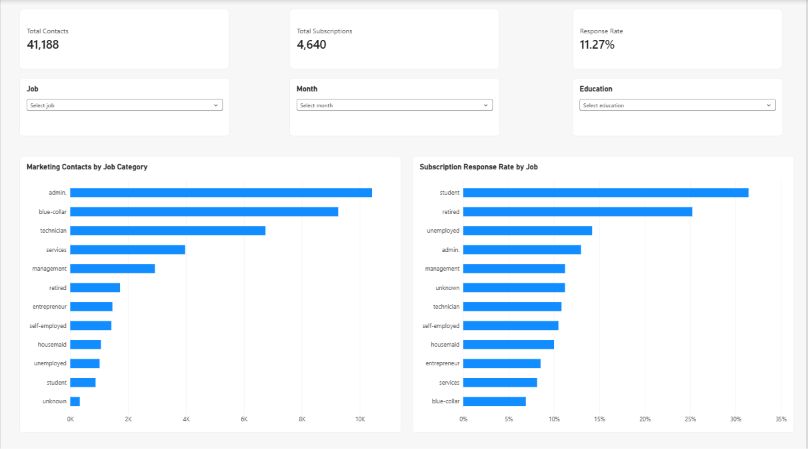
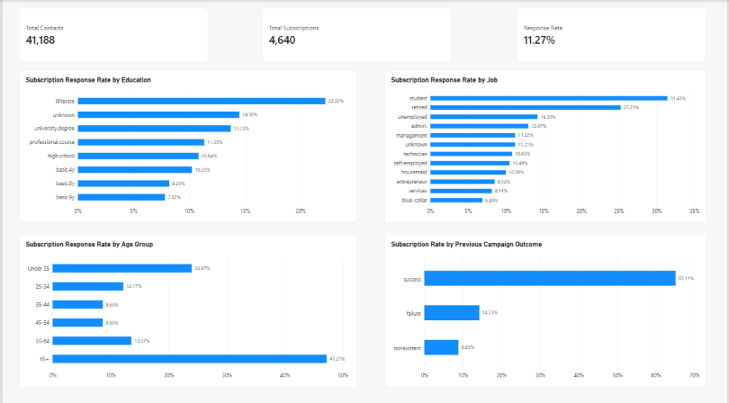
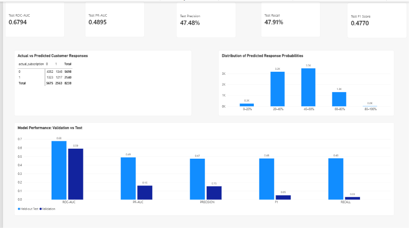
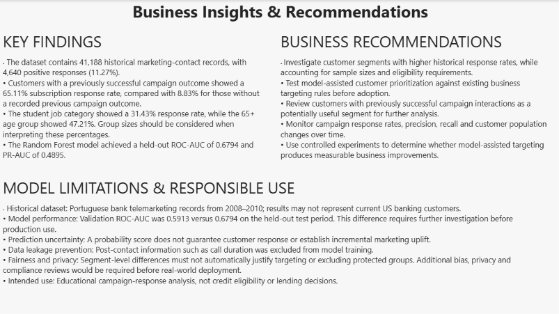

# Customer Offer Prediction and Analysis

## Project Overview

This project focuses on analyzing bank marketing campaign data and predicting whether a customer is likely to respond positively to a term-deposit offer.

I used Python, SQL, and machine learning to explore customer behavior, analyze campaign response patterns, and build a prediction model. I also created a Power BI dashboard to present the findings and a FastAPI service to demonstrate how the trained model can generate predictions.

The main goal is to understand how data analytics and machine learning can support marketing decisions.

## Business Problem

Banks run marketing campaigns to promote financial products, but not every customer responds positively.

Understanding customer behavior and identifying potential responders can help marketing teams make more informed targeting decisions.

This project focuses on answering the following questions:

- Which customer groups show higher historical response rates?
- How do job, education, age, and previous campaign outcomes relate to subscriptions?
- Can machine learning estimate the probability of a positive response?
- Which factors are useful for predicting campaign responses?
- How can these findings be presented through interactive reports?

## Dataset

**Source:** [UCI Bank Marketing Dataset](https://archive.ics.uci.edu/dataset/222/bank+marketing)

The project uses `bank-additional-full.csv`, which contains historical Portuguese bank marketing campaign data.

**Dataset details:**
- Total records: 41,188
- Positive responses: 4,640
- Overall response rate: 11.27%
- Target variable: `y` (yes/no subscription)
- Data type: Numerical and categorical features

The dataset contains marketing-contact records rather than unique customer records. Some customers may have been contacted multiple times.

The original dataset is included in `data/raw/`. A separate synthetic dataset is available for testing purposes.

## Technologies Used

| Category | Technologies |
|---|---|
| Programming | Python, SQL |
| Data Analysis | Pandas, NumPy |
| Machine Learning | scikit-learn, Logistic Regression, Random Forest, K-Means |
| Database | PostgreSQL |
| Visualization | Power BI, Matplotlib |
| API Development | FastAPI, Uvicorn |
| Model Storage | Joblib |
| Testing | Pytest |
| Version Control | Git, GitHub |

## Project Workflow

The project follows these steps:

1. Load and validate the banking campaign dataset.
2. Analyze customer and campaign response patterns using Python and SQL.
3. Clean and prepare the data for machine learning.
4. Select features available before a customer contact.
5. Train and compare classification models.
6. Evaluate the selected model on a held-out test dataset.
7. Explore campaign-contact history patterns using K-Means clustering.
8. Create interactive Power BI reports.
9. Build a FastAPI endpoint for customer response predictions.

## Data Analysis

The initial analysis focuses on:

- Overall campaign response rates
- Customer age groups
- Job and education categories
- Previous campaign outcomes
- Marketing channels
- Housing and personal loan information
- Campaign-contact patterns

SQL scripts are included for campaign reporting and data analysis.

## Machine Learning

### Models Used

Two classification models were evaluated:

- Logistic Regression
- Random Forest

Random Forest was selected based on validation PR-AUC.

### Data Preparation

Numerical and categorical features were processed using reusable preprocessing steps.

The `duration` field was excluded from model training because call duration is only known after a call has taken place.

Other contact-time fields were also excluded to keep the prediction use case focused on information available before contacting a customer.

### Dataset Split

The historical data was divided chronologically:

| Dataset | Records |
|---|---:|
| Training | 26,772 |
| Validation | 6,178 |
| Testing | 8,238 |

The final selected model was refitted using the training and validation periods before evaluation on the held-out test set.

### Model Performance

The selected Random Forest model produced the following results on the held-out test dataset:

| Metric | Result |
|---|---:|
| ROC-AUC | 0.6794 |
| PR-AUC | 0.4895 |
| Precision | 0.4748 |
| Recall | 0.4791 |
| F1 Score | 0.4770 |
| Brier Score | 0.2114 |

These results show the model's performance on the historical test data. They do not guarantee similar performance on future or real-world campaigns.

Model performance also differed between the validation and test periods, so further evaluation would be needed before practical business use.

### Customer Segmentation

K-Means clustering was used to explore patterns in previous campaign-contact history.

Since the dataset does not contain unique customer identifiers, the resulting groups represent contact-history patterns rather than confirmed groups of distinct customers.

## Power BI Dashboard

An interactive four-page Power BI report was created to present campaign analysis and machine learning results.

The report is available at:

`powerbi/Customer_Offer_Prediction.pbix`

### Page 1 — Campaign Overview

Provides an overview of campaign performance, including:

- Total Contacts
- Total Subscriptions
- Response Rate
- Marketing Contacts by Job
- Subscription Response Rate by Job
- Interactive Job, Education, and Month filters



### Page 2 — Customer Analysis

Explores differences in response rates across customer characteristics.

Visualizations include:

- Subscription Response Rate by Education
- Subscription Response Rate by Job
- Subscription Response Rate by Age Group
- Response Rate by Previous Campaign Outcome



### Page 3 — Prediction and Model Performance

Displays the results of the machine learning model.

Visualizations include:

- ROC-AUC, PR-AUC, Precision, Recall, and F1 Score
- Actual vs. Predicted Outcomes
- Prediction Probability Distribution
- Validation vs. Test Model Performance



### Page 4 — Business Insights and Recommendations

Summarizes the findings from the analysis and explains how the results could support marketing decisions.

This page includes:

- Key Campaign Findings
- Business Recommendations
- Model Limitations
- Responsible Use Considerations



The `.pbix` file can be opened using Power BI Desktop. Data source paths may need to be updated when opening the report on another computer.

## Prediction API

A FastAPI service was developed to demonstrate how the trained model can be used to generate customer response predictions.

### Available Endpoints

| Endpoint | Method | Purpose |
|---|---|---|
| `/health` | GET | Checks API status and model availability |
| `/predict` | POST | Generates an estimated response probability |

The API accepts supported customer and campaign-history features and returns a model-based prediction.

The service was tested locally using FastAPI's interactive documentation.

The API is not publicly deployed.

## How to Run the Project

### 1. Clone the Repository

```bash
git clone https://github.com/Yamini-Veerabhadra/Customer_Offer_Prediction.git
cd Customer_Offer_Prediction
```

Replace `YOUR_USERNAME` with your GitHub username.

### 2. Create a Virtual Environment

For Windows:

```powershell
py -3 -m venv .venv
```

### 3. Install Dependencies

Use the virtual environment's Python directly:

```powershell
.\.venv\Scripts\python.exe -m pip install -r requirements.txt
```

### 4. Run Automated Tests

```powershell
.\.venv\Scripts\python.exe -m pytest -q
```

### 5. Run the Data Analysis and Machine Learning Pipeline

```powershell
.\.venv\Scripts\python.exe -m src.project --data data/raw/bank-additional-full.csv
```

This regenerates the analysis, model, and reporting outputs using the UCI dataset.

### 6. Start the Prediction API

```powershell
.\.venv\Scripts\python.exe -m uvicorn api.main:app --reload
```

Open this address in a browser:

`http://127.0.0.1:8000/docs`

The sample prediction request is available in:

`docs/EXAMPLE_API_REQUEST.json`

**Note:** Running the pipeline again can overwrite saved model and reporting outputs. The synthetic sample should only be used for testing and should not be confused with the real-data results.

## Project Structure

```text
Customer-Offer-Prediction/
|
|-- api/                   # FastAPI prediction service
|-- data/                  # Original and demo datasets
|-- docs/                  # Documentation and examples
|-- outputs/               # Analysis results and trained model
|-- powerbi/               # Power BI dashboard and related files
|-- Screenshots/            # Power BI dashboard screenshots
|-- sql/                   # Database schema and analysis queries
|-- src/                   # Python analysis and ML pipeline
|-- tests/                 # Automated tests
|-- .github/workflows/     # GitHub Actions
|-- README.md
|-- requirements.txt
|-- .gitignore
```

## Key Findings

The historical data analysis showed several differences in customer response behavior:

- The overall subscription response rate was approximately 11.27%.
- Customers with previously successful campaign outcomes showed higher response rates than customers without recorded previous campaign outcomes.
- Response rates varied across job categories, education levels, and age groups.
- The Random Forest model demonstrated moderate ability to distinguish positive and negative responses on the held-out test data.

These findings describe historical patterns and should not be interpreted as evidence of causal relationships.

## Business Recommendations

Based on the analysis, potential next steps for a marketing team include:

- Review customer segments with higher historical response rates.
- Compare model-assisted customer prioritization with existing targeting strategies.
- Investigate the relationship between previous campaign interactions and current responses.
- Monitor prediction performance as new campaign data becomes available.
- Use controlled experiments before claiming that predictive targeting improves campaign conversion.

## Limitations

This project uses historical Portuguese banking data collected between 2008 and 2010.

The dataset does not necessarily represent current banking customers or marketing practices.

Additional limitations include:

- The dataset does not provide unique customer identifiers.
- Model performance varies across evaluation periods.
- Predictions do not establish incremental campaign uplift.
- The prediction API is intended for local demonstration.
- Additional fairness, privacy, and compliance evaluation would be required before operational use.

The model is not intended for lending, credit eligibility, or other high-stakes financial decisions.

## Conclusion

This project helped me practice an end-to-end analytics workflow, starting with data preparation and exploratory analysis and moving into machine learning, model evaluation, Power BI reporting, and API development.

It demonstrates how traditional business analytics and practical machine learning can be combined to investigate customer response patterns and support data-informed marketing decisions.

## Dataset Attribution

Moro, S., Rita, P., & Cortez, P. (2014). *Bank Marketing* [Dataset]. UCI Machine Learning Repository.

DOI: https://doi.org/10.24432/C5K306

Dataset license: CC BY 4.0.
